



<p class="center">
  <a href="https://github.com/carla-simulator/carla/releases/tag/1.0" target="_blank" class="btn btn-primary" title="Go to CARLA releases" style="text-decoration: none;">
    Get CARLA 1.0
  </a>
</p>

We are proud to present __CARLA 1.0__. CARLA ran its first internal release in 2016 and went public in 2017; after all these years, this is the release where we can say CARLA is ready for 1.0. It is the most important release in the history of the project, both for what it does and for what it now lets the community do.

__CARLA is now a full agentic platform.__ Your AI agent can install, build, run and drive CARLA for you: start a server, populate a city, mount a sensor rig, write and run a scenario, test an autonomous driving stack and read back the results, following procedures that the CARLA team has vetted step by step. This is the modernisation of CARLA, and it changes how you work with the simulator.

__CARLA now delivers state-of-the-art sensor simulation.__ Producing high-quality sensor data has always been one of CARLA's core missions, and today we can say that our sensors are state of the art: __NVIDIA NuRec__ neural reconstruction of real drives, __NVIDIA Cosmos__ world models, __DLSS 4.5__, new cameras path traced through __real lens models__, and a library of __camera profiles calibrated against real automotive datasets__.

And all of it runs on __Unreal Engine 5.8__, with the content that the move to Unreal Engine 5 had left behind brought back: the classic towns, the large maps, dynamic weather and a much larger asset library, plus a new town.

Thank you to everyone who has built, tested, reported and contributed to CARLA over these years. Version 1.0 is yours as much as ours.

---

### 🚀 CARLA on Unreal Engine 5.8

CARLA 1.0 moves from Unreal Engine 5.5 to __Unreal Engine 5.8__, on CARLA's own fork of the engine. Everything in this release builds on it:

- __World Partition streaming__ and __Large World Coordinates__, which bring back the large maps
- __Lumen global illumination__ and __virtual shadow maps__, with hardware ray tracing available
- The __path tracer__, which the new ray-traced lens cameras render through
- __Ubuntu 24.04__ alongside 22.04, and the __NVIDIA RTX 50 series__

The quality levels have been rebuilt on the engine's scalability groups. Every level keeps the full view distance, foliage density and simulation content, so lowering the quality only costs image quality and never changes what a sensor sees.

---

### 🤖 Agentic CARLA

<video class="post-video" autoplay muted loop playsinline src="/img/posts/2026-11-17/clips/agentic.mp4"></video>
<div class="post-slideshow-caption">A coding agent drives CARLA through the skills: placing the spectator over a junction, spawning traffic and setting the weather</div>

With CARLA 1.0, you can work with the simulator by describing what you want. Ask your AI agent to "build CARLA and start a server on Town12", "spawn heavy traffic and make it rain at dusk", "mount a front camera and a lidar and save their data", "write a scenario where a car cuts in from the right" or "evaluate my agent on these Leaderboard routes", and it does the work, end to end.

What makes this reliable is the __CARLA skill library__: __64 vetted procedures__, written and tested by the CARLA team, that cover the whole life cycle of a CARLA project:

- __Set up__: download a release or build from source, install the Python API, ScenarioRunner, Scenic and the Leaderboard at the versions that match your CARLA.
- __Create content__: import maps, vehicles, props and pedestrians, and package the result.
- __Simulate__: run servers, load maps, set the weather, spawn traffic and pedestrians, attach and read sensors, record and replay.
- __Test__: write and run ScenarioRunner, OpenSCENARIO and Scenic scenarios, evaluate Leaderboard agents and analyse their results, run Autoware over ROS 2.

Each skill encodes the failure modes that make the naive approach fail, so your agent does not lose a day to them. The new __CARLA MCP server__ (`Util/AgenticTools/`) serves the library to any agent that speaks the Model Context Protocol: it finds the right skill, checks its prerequisites against your machine and remembers your CARLA paths between sessions. See [Agentic CARLA skills](https://carla-ue5.readthedocs.io/en/latest/agent_skills/).

---

### 🎥 State-of-the-art sensor simulation

#### NVIDIA NuRec 26.04

<video class="post-video" autoplay muted loop playsinline src="/img/posts/2026-11-17/clips/nurec_cameras.mp4"></video>
<div class="post-slideshow-caption">A NuRec scene reconstructed from a real night drive, its seven cameras rendered in one batched round trip</div>

With __NVIDIA NuRec 26.04__, a recorded real-world drive becomes a scene that CARLA can simulate. CARLA owns the physics and the clock, and the NuRec renderer produces photoreal camera frames and, from 26.04, lidar sweeps of the reconstructed scene. All the cameras due in a tick are rendered in one batched round trip, the ego and the other vehicles can be re-driven with CARLA physics or the Traffic Manager, and the new asset editing swaps the rendered asset of a vehicle or inserts a clone with a shifted trajectory. See [NVIDIA NuRec](https://carla-ue5.readthedocs.io/en/latest/nvidia_nurec/).

#### NVIDIA Cosmos

<video class="post-video" autoplay muted loop playsinline src="/img/posts/2026-11-17/clips/cosmos_carla.mp4"></video>
<div class="post-slideshow-caption">Cosmos 3 turns a CARLA drive (left) into photoreal footage (right), guided by the world-scenario control (centre) exported from CARLA's ground truth</div>

<video class="post-video" autoplay muted loop playsinline src="/img/posts/2026-11-17/clips/cosmos_edge.mp4"></video>
<div class="post-slideshow-caption">Cosmos Transfer 2.5 relights the same drive as golden hour from its edge control</div>

CARLA drives can now feed NVIDIA's __Cosmos__ world models, with support for __Cosmos 2.5, 2.5-AV and Cosmos 3__. A recorded run becomes photoreal variations of itself, with a different weather, time of day or road surface over the same trajectory. `PythonAPI/examples/nvidia/cosmos/` captures frame-exact multi-camera clips with their depth, segmentation and edge control videos, exports the ground truth as an NVIDIA ClipGT scene package, and submits the generation jobs through the `carla-cosmos` CLI. The capture client, the CLI and the job server ship ready to use, with a mock worker that runs the whole pipeline without a GPU; the Cosmos 3 and Transfer 2.5 workers that run the models are still being validated on GPU hardware. See [NVIDIA Cosmos](https://carla-ue5.readthedocs.io/en/latest/nvidia_cosmos/).

#### DLSS 4.5

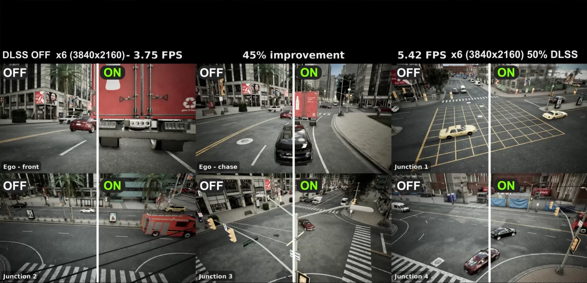{:class="img-fluid rounded mx-auto d-block zoomable"}

NVIDIA __DLSS 4.5__ is integrated into the simulator itself:

- __DLSS Super Resolution__ upscales any camera sensor: the camera renders internally at a fraction of its output resolution and DLSS reconstructs the full-size image. In the example above, a rig of six 4K RGB cameras renders 40 to 50% faster with DLSS on.
- __DLSS Ray Reconstruction__ denoises the path-traced frames of the ray-traced lens cameras, so they run in real time at low sample counts.

The multi-camera pipeline is faster too, before DLSS even starts: all the cameras share one GPU synchronisation per tick, and ray-cast lidars simulate in parallel on background tasks. See [NVIDIA DLSS](https://carla-ue5.readthedocs.io/en/latest/core_dlss/).

#### Ray-traced lenses



The new __ray-traced lens cameras__ are path traced through real lens models (pinhole, Kannala-Brandt fisheye, Brown-Conrady barrel and NVIDIA's `ftheta` polynomial). Unlike a distortion applied on top of a pinhole render, every ray leaves through the lens itself, so a 150° fisheye is exact out to the edge of the frame, with no seams:

- `sensor.camera.rt_lens` (RGB)
- `sensor.camera.rt_lens_distance` (Euclidean distance, exact for every lens model)
- `sensor.camera.rt_lens_instance` (instance and semantic segmentation)

The cameras can also capture only a subset of actors, for compositing with real footage. CARLA 1.0 also adds a __Hybrid Solid-State LiDAR__ modelled on the Hesai AT128 and the __V2X__ sensor family. See the [Sensors reference](https://carla-ue5.readthedocs.io/en/latest/ref_sensors/).

#### Camera profiles calibrated against real cameras


<div class="post-slideshow-caption">Each profile from the ego vehicle, with the resolution, field of view and lens of the camera it imitates. Inset: a real frame of that camera.</div>

A camera's look now comes from a __profile__. Six of the nine profiles that ship with CARLA reproduce the camera of a public driving dataset, tuned frame by frame against that dataset (exposure, contrast, saturation, white balance, sharpness and noise at every brightness), and two more reproduce consumer cameras. In the slides, each CARLA scene is staged to match a real frame of that camera, with the same kind of street, traffic and pedestrians, so that colour, shadows and contrast can be compared directly:

| Profile | Real camera | Look |
| --- | --- | --- |
| `AutomotiveHDR` (default) | nuScenes front camera (Basler acA1600-60gc) | Flat machine-vision camera: neutral, low saturation, fast auto exposure, lens flare and sensor noise that rise in the dark. |
| `AutomotiveHDRClean` | Same camera, better sensor and optics | Same exposure and tone mapping, with little glare and noise, for clean ground truth. |
| `WideHDR8MP` | 8 MP 120° ADAS front camera (Zenseact ZOD) | Multi-exposure HDR: no clipped highlights, lifted blacks, strong noise reduction. |
| `LegacyCCD` | KITTI (Point Grey Flea2 CCD) | Low dynamic range: clipped skies, steep contrast, sharp. |
| `LogHDR` | Cityscapes (onsemi AR0331) | HDR log-compressed to 8 bit: no clipped highlights, lifted shadows, grey-green cast. |
| `Smartphone` | comma.ai road camera (Sony IMX298) | Phone ISP: cool white balance, saturated, soft codec detail. |
| `GoPro` | Action camera | Vivid, contrasty colour, crisp detail, wide fisheye lens. |
| `Dashcam` | Consumer dashcam | Bright and flat, vivid colour, over-sharpened, strong vignette, wide barrel lens. |
| `Cinematic` | Photo and film camera | Filmic grading for the spectator view; not modelled on a reference camera. |

At night the difference between `AutomotiveHDR` and `AutomotiveHDRClean` is easiest to see. Both keep the same look, with the same exposure, tone mapping and colour, but the clean version removes most of the sensor noise and the glare around the lights, for when you want the camera's look without its defects:


<div class="post-slideshow-caption">Reference frames: <a href="https://www.nuscenes.org/">nuScenes</a> (CC BY-NC-SA 4.0), <a href="https://zod.zenseact.com/">Zenseact ZOD</a> (CC BY-SA 4.0), <a href="https://www.cvlibs.net/datasets/kitti/">KITTI</a> (CC BY-NC-SA 3.0), <a href="https://www.cityscapes-dataset.com/">Cityscapes</a>, <a href="https://github.com/commaai/comma10k">comma10k</a> (MIT); action camera by live360 on Mapillary via Wikimedia Commons (CC BY-SA 4.0), dashcam by Michael Rivera via Wikimedia Commons (CC BY 4.0).</div>

With the profiles come exposure-linked motion blur, sensor noise and optical softness that follow the auto exposure, and an FFT lens flare measured on the nuScenes night frames. Pick a profile with one attribute, and match the resolution, field of view and lens of the real camera:

```py
camera_bp = blueprint_library.find('sensor.camera.rgb')
camera_bp.set_attribute('post_process_profile', 'LegacyCCD')
```

__Simulate your own camera.__ The profiles are plain JSON files, and the same tools we used to build them are in the editor: tune exposure, tone curve, white balance, bloom, noise and lens flare against frames of your real camera, save the result as a new profile, and every sensor can load it by name. Pair it with the resolution, field of view and lens model of your camera, and CARLA renders what your real rig would see. `manual_control.py` cycles through the profiles with K / Shift+K. See [Camera presets](https://carla-ue5.readthedocs.io/en/latest/core_camera_presets/).

---

### 🗺️ Content: everything is back, and more

When CARLA moved to Unreal Engine 5 with version 0.10.0, only part of the content made the journey: Town10 and the Mine map, a dozen vehicles, fixed daylight weather, and no large maps or map layers. CARLA 1.0 brings it all back on Unreal Engine 5.8, and adds more:

| | In CARLA 1.0 |
| --- | --- |
| [__15 Maps__](https://carla-ue5.readthedocs.io/en/latest/catalogue/#maps) | Town10HD, Town12 and Town15 in the default package; Town01 to Town07, Town11, Town13, Town_C, Mine_01 and Eixample as additional content packs. Each map has a page with its size, spawn points, junctions and districts |
| [__26 Vehicles__](https://carla-ue5.readthedocs.io/en/latest/catalogue_vehicles/) | 13 cars, 4 motorcycles, 3 bicycles, 3 trucks, 1 van, 1 bus and 1 mining earth mover |
| [__37 Pedestrians__](https://carla-ue5.readthedocs.io/en/latest/catalogue_pedestrians/) | 31 adults, 4 children and 2 police officers; 6 of them can use a __wheelchair__ |
| [__82 Props__](https://carla-ue5.readthedocs.io/en/latest/catalogue_props/) | Spawnable: containers, garbage, park and garden, personal items, road works and debris, sidewalk furniture and signs, and calibration targets |
| __22 Weather presets__ | Dynamic again: from noon to sunset and night, clear to hard rain and dust storm, with physically based lighting |

<div class="post-assets post-maps">
  <a href="https://carla-ue5.readthedocs.io/en/latest/map_town10/" target="_blank">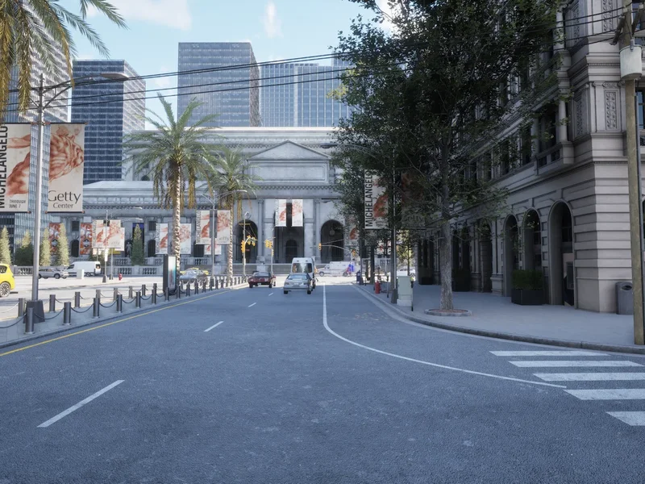<span><b>Town10HD</b><br>Downtown with skyscrapers and boulevards</span></a>
  <a href="https://carla-ue5.readthedocs.io/en/latest/map_town15/" target="_blank">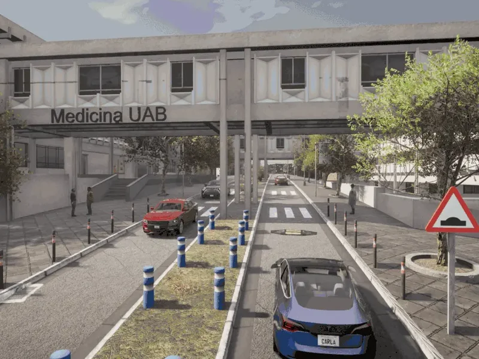<span><b>Town15</b><br>Autonomous University of Barcelona campus</span></a>
  <a href="https://carla-ue5.readthedocs.io/en/latest/map_town12/" target="_blank">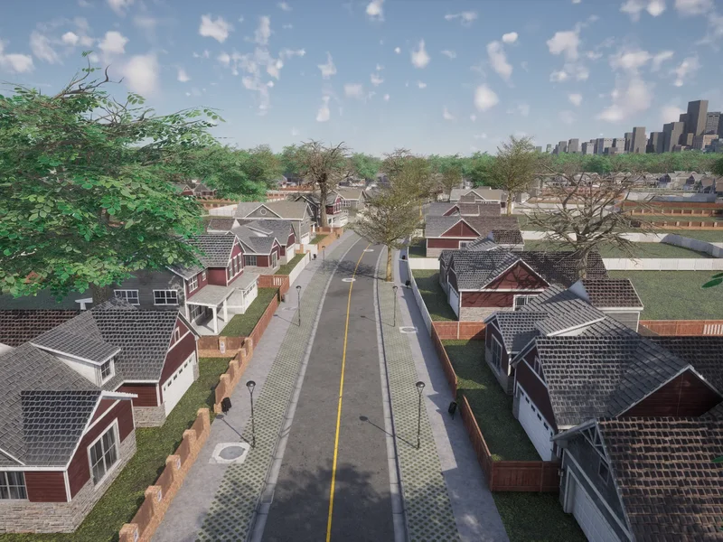<span><b>Town12</b><br>10 x 10 km: downtown, suburbs, highway and farmland</span></a>
  <a href="https://carla-ue5.readthedocs.io/en/latest/map_mine/" target="_blank">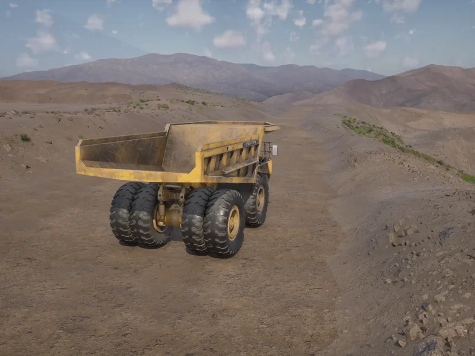<span><b>Mine_01</b><br>Open-cast mine with its access roads</span></a>
</div>

<div class="post-assets">
  <a href="https://carla-ue5.readthedocs.io/en/latest/catalogue_vehicles/" target="_blank">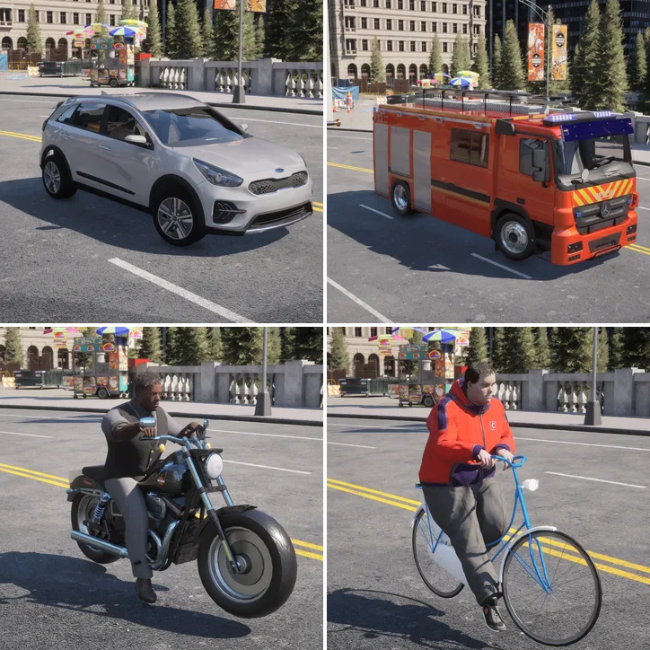<span><b>26 vehicles</b><br>Cars, trucks, emergency vehicles, motorcycles and bicycles</span></a>
  <a href="https://carla-ue5.readthedocs.io/en/latest/catalogue_pedestrians/" target="_blank">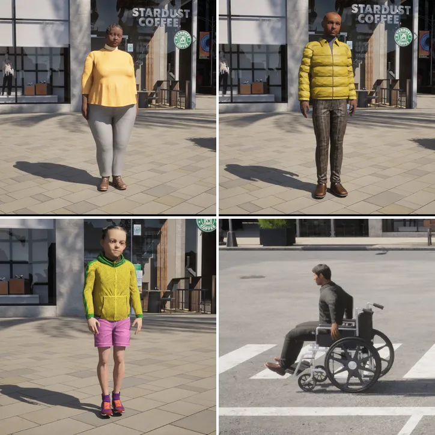<span><b>37 pedestrians</b><br>Adults, children and police officers; six of them can use a wheelchair</span></a>
  <a href="https://carla-ue5.readthedocs.io/en/latest/catalogue_props/" target="_blank">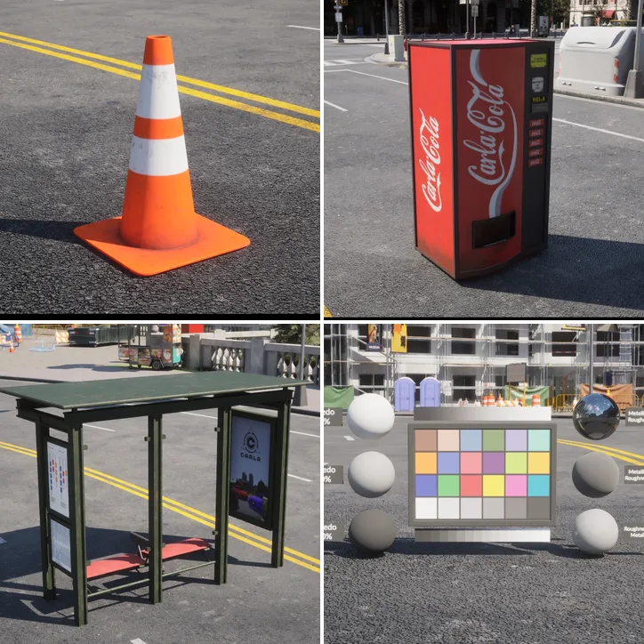<span><b>82 props</b><br>Road works, street furniture, debris and calibration targets</span></a>
</div>


#### Large maps



Navigate environments that are kilometres long, and now with pedestrians. __Town11, Town12, Town13 and Town15__ stream their cells in and out around the vehicles through World Partition, instead of CARLA's old tiling. There is no rebasing and nothing tiled on the client side: from the Python API they behave like any other map, and pedestrians navigate them server side. Every vehicle keeps the ground under itself loaded, and a vehicle whose `role_name` is `hero` gets a wider ring, set by `tile_stream_distance` in `carla.WorldSettings`. See [Large maps](https://carla-ue5.readthedocs.io/en/latest/core_large_maps/).

#### Dynamic weather


<div class="post-slideshow-caption">Seen from the ego vehicle's camera with the default AutomotiveHDR profile.</div>

The weather API drives the Unreal Engine 5 sky rig again, with next-generation lighting. Street lamps emit real light in lumens, vehicle headlights cast their beams, and the moon and stars light the night. Rain falls per camera, with droplets on the lens. The vehicle lights have been balanced across the whole fleet, and the new __environment-map lighting__ (`World.set_sky_light_map`) lights the actors with an HDR panorama, for compositing with real footage or neural scenes. The intensity and colour of street lamps, building windows, traffic lights and vehicle lights are set per class in one JSON file from the new __Light Defaults__ panel in the editor, so a new lamp or vehicle can be matched to the rest of the city. See [Lights](https://carla-ue5.readthedocs.io/en/latest/content_authoring_lights/).

#### The classic towns



The towns that a generation of autonomous driving research was trained and evaluated on are back. __Town01 to Town07__ return migrated to the new lighting stack, as layered maps: load them by their `_Opt` name and toggle their layers with [carla.MapLayer](https://carla-ue5.readthedocs.io/en/latest/core_map/).

```py
client.load_world('Town03_Opt')
```

#### New town: Town_C



__Town_C__ is a new China-inspired environment authored by CARLA consortium member and sponsor [Synkrotron](https://www.synkrotron.ai/). It is modelled on the Shanghai International Automobile City in Jiading, with recreations of its landmark buildings: the Shanghai Poly Grand Theatre, the Shanghai Automotive Exhibition Center, the Shanghai Auto Museum and more. See [Town_C](https://carla-ue5.readthedocs.io/en/latest/map_town_c/).

#### Digital twins



The __Digital Twin Tool__ makes new-map creation fast from __OpenStreetMap__ data: the street layout becomes an OpenDRIVE road network and road meshes, and the spaces between the roads are filled with procedural buildings, trees and plants, street furniture, traffic lights and traffic signs. The Eixample district of Barcelona shows the whole path, from map to simulation. In CARLA 1.0 the tool is a preview: the command-line pipeline builds a twin end to end, the procedural buildings need the optional `CarlaDigitalTwinsTool` content (about 18 GB, downloaded separately), and the editor widget is not usable yet. See [Digital Twin Tool](https://carla-ue5.readthedocs.io/en/latest/content_authoring_maps_digital_twin/).

#### Your own maps and assets

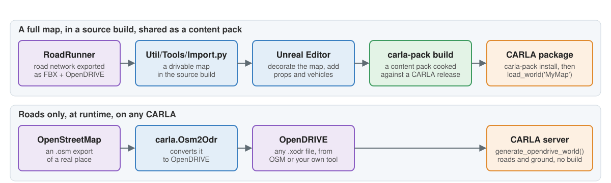{:class="img-fluid rounded mx-auto d-block zoomable"}
<div class="post-slideshow-caption">Two ways to bring a map into CARLA: a full map shipped as a content pack, or an OpenDRIVE road network loaded at runtime</div>

Bring your own maps into CARLA. Export the road network from RoadRunner as FBX and OpenDRIVE, and `Util/Tools/Import.py` turns it into a drivable map in a source build, ready to decorate in the editor. An OpenDRIVE file alone is enough to drive on at runtime with `client.generate_opendrive_world()`, and OpenStreetMap data converts to OpenDRIVE again. To share what you build, put your maps, props and vehicles in a __content pack__: `carla-pack` cooks them against a CARLA release, and installing the pack adds them to that CARLA package without rebuilding or repackaging it. The towns that the default package leaves out are distributed the same way. See [Create a map](https://carla-ue5.readthedocs.io/en/latest/content_authoring_maps/) and [Content packs](https://carla-ue5.readthedocs.io/en/latest/content_authoring_packs/).

---

### 🚗 AV stacks

#### Autoware

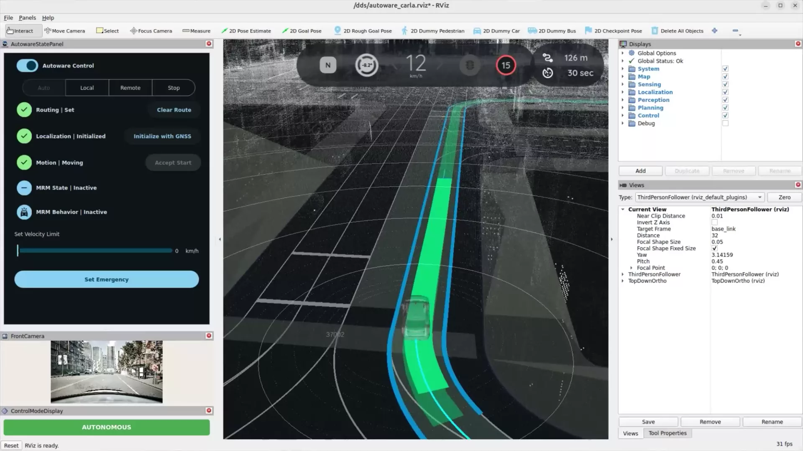{:class="img-fluid rounded mx-auto d-block zoomable"}

Test your Autoware stack in CARLA out of the box, over CARLA's native ROS 2 interface and with no bridge process. The CARLA-Autoware map generator gains stop signs, more reliable traffic-light lane linking and a traffic-light state bridge, and `run_carla_autoware.sh --with-rviz` starts RViz on a CARLA-adapted config. The native ROS 2 interface now lets you __choose the middleware__ at launch (FastDDS, CycloneDDS or Zenoh) with `--rmw=` and `--ros-domain-id=`. See [Autoware](https://carla-ue5.readthedocs.io/en/latest/autoware/) and [ROS 2 native interface](https://carla-ue5.readthedocs.io/en/latest/ros2_native/).

#### NVIDIA Alpamayo 2 Super

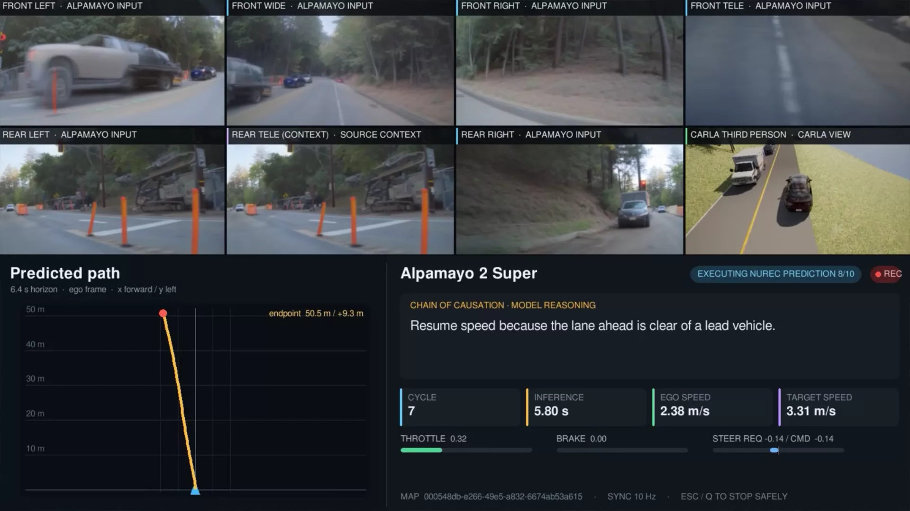{:class="img-fluid rounded mx-auto d-block zoomable"}

Test __NVIDIA Alpamayo 2 Super__ in CARLA, natively or inside a NuRec scene. The closed-loop example captures the model's calibrated cameras and ego-motion history, runs the trajectory inference, shows the predicted path and the model's Chain of Causation reasoning, and turns the trajectory into vehicle control. It runs with CARLA-rendered cameras on any CARLA map, or with NuRec cameras on a reconstructed real-world scene (see [below](#nurec--alpamayo-2-super-closed-loop-on-a-real-road)). See [Run NVIDIA Alpamayo 2 Super in CARLA](https://carla-ue5.readthedocs.io/en/latest/nvidia_alpamayo/).

---

### 🎬 AV scenario design

<video class="post-video" autoplay muted loop playsinline src="/img/posts/2026-11-17/clips/scenic_scenarios.mp4"></video>
<div class="post-slideshow-caption">Scenic scenarios on Town10, each with a second camera on the ego vehicle</div>

Scenarios are how an autonomous driving stack is tested, and CARLA 1.0 supports the latest __ScenarioRunner__ (Python scenarios and OpenSCENARIO), __Scenic__ and the __CARLA Leaderboard__. The skill library covers all of them, so your agent can install the right version for your CARLA, write a scenario from a description, run it and read back the results. See [ScenarioRunner](https://carla-ue5.readthedocs.io/en/latest/scenario_runner/) and [Scenic](https://carla-ue5.readthedocs.io/en/latest/scenic/).

#### New workflows: CARLA meets real-world data

CARLA 1.0 connects the simulator with neural reconstruction, world models and end-to-end driving models in workflows that were not possible before. They all share one idea: CARLA keeps what a simulator is good at, the physics, the clock, the actors and the ground truth, and the NVIDIA models bring the look and the behaviour of the real world.

##### Your scenario, on a real road: Scenic + NuRec + CARLA assets

<video class="post-video" autoplay muted loop playsinline src="/img/posts/2026-11-17/clips/nurec_cut_in.mp4"></video>
<div class="post-slideshow-caption">Highway cut-in: a CARLA vehicle, driven by a Scenic scenario, cuts in front of the ego inside a NuRec scene</div>

Describe the scenario you want to test, and your agent writes it in Scenic with CARLA's own vehicles and pedestrians. The hybrid pipeline then runs it inside a NuRec scene reconstructed from a real drive:

- Scenic receives the real road network of the scene and drives the ego, which carries the recorded camera, and every other agent.
- The CARLA actors are path traced through the __recorded camera's own lens__ (NVIDIA's `ftheta` model) and hidden wherever the neural scene's geometry is in front of them, pixel by pixel.
- The sun is found in the reconstructed scene and the actors are lit by it, cast their shadows on the real road, and are exposed like the real camera.
- NVIDIA's diffusion __Harmonizer__ blends the composite, frame by frame or over time, so the inserted actors match the photometry of the drive.

The result is a scenario you designed, on a road that exists, with the look of the real camera, and with CARLA's ground truth for every inserted actor. Five scenarios ship as examples:

<div class="post-video-grid">
  <div><video class="post-video" autoplay muted loop playsinline src="/img/posts/2026-11-17/clips/hybrid_overtake.mp4"></video><div class="post-slideshow-caption">Highway overtake</div></div>
  <div><video class="post-video" autoplay muted loop playsinline src="/img/posts/2026-11-17/clips/hybrid_brake_wave.mp4"></video><div class="post-slideshow-caption">Highway brake wave</div></div>
  <div><video class="post-video" autoplay muted loop playsinline src="/img/posts/2026-11-17/clips/hybrid_stop_and_go.mp4"></video><div class="post-slideshow-caption">Urban stop-and-go</div></div>
  <div><video class="post-video" autoplay muted loop playsinline src="/img/posts/2026-11-17/clips/hybrid_pull_out.mp4"></video><div class="post-slideshow-caption">Urban pull-out</div></div>
</div>

See [Hybrid rendering](https://carla-ue5.readthedocs.io/en/latest/nvidia_nurec/#hybrid-rendering-example).

##### NuRec + Alpamayo 2 Super: closed loop on a real road

<video class="post-video" autoplay muted loop playsinline src="/img/posts/2026-11-17/clips/nurec_alpamayo.mp4"></video>
<div class="post-slideshow-caption">Alpamayo 2 Super drives a NuRec scene in closed loop: the cameras it sees, its predicted path, its Chain of Causation reasoning and the CARLA view of the same moment</div>

Alpamayo 2 Super can drive a NuRec scene in closed loop. NuRec renders the model's calibrated cameras from the reconstructed real drive, Alpamayo predicts the trajectory and explains it, and CARLA turns that trajectory into vehicle control and moves the ego through the scene, so the next frames are rendered from where the model actually drove. An end-to-end model tested on a real road, without driving a real car. See [Run with NuRec cameras](https://carla-ue5.readthedocs.io/en/latest/nvidia_alpamayo/#run-with-nurec-cameras).

##### NuRec + Cosmos: one real drive, any condition

<video class="post-video" autoplay muted loop playsinline src="/img/posts/2026-11-17/clips/cosmos_nurec.mp4"></video>
<div class="post-slideshow-caption">A NuRec drive recorded at night (left) becomes a clear day (right): Cosmos 3 follows the world-scenario control (centre) built from the scene's own road network and trajectory</div>

A NuRec scene can also condition Cosmos. `nurec_to_cosmos.py` conditions it three ways: on the __world model__ of the drive (the scene's own OpenDRIVE map and ego trajectory, exported as a ClipGT scene package), on the __neural RGB__ of the real place, or on both with Cosmos 3. One recorded drive becomes the same road in other weathers, times of day and seasons. See [NVIDIA in CARLA](https://carla-ue5.readthedocs.io/en/latest/nvidia/).

---

### 🐍 Python API

- __Road network objects__: `carla.Road`, `carla.LaneSection` and `carla.Lane`, so the map can be addressed as objects instead of only sampled as waypoints (`Map.get_roads`, `Map.get_junctions`, `Waypoint.get_lane`, `Junction.get_entry_lanes` and more).
- __Geolocation that follows the map's own projection__: the OpenDRIVE `geoReference` is read into a typed projection (Transverse Mercator, UTM, Web Mercator or Lambert Conformal Conic) through `Map.get_geoprojection`, with the new `Map.geolocation_to_transform`.
- __`Vehicle.get_telemetry_data()` is back__, with control, speed, RPM, gear and per-wheel slip from the Chaos physics state.
- __Wheel animation override__ for replays and co-simulation, and __wheels that turn__ when Chaos is not simulating the vehicle.
- __Actor introspection__: component, bone and socket names and transforms.
- The __recorder__ now records the weather and the wheels, and can replay one recording while recording another.
- __Deterministic collisions__ (`WorldSettings.deterministic_collisions`): in synchronous mode the same crash now happens in the same frame on every run, however fast the server runs.
- `Vehicle.is_door_open()` reads whether a door is open, whoever opened it.

#### API changes to check in your scripts

- `carla.Waypoint.get_right_lane`/`get_left_lane` are renamed `get_right_waypoint`/`get_left_waypoint`, and `carla.GeoOffsetTransform.ApplyTransformation` is renamed `apply_transform`. The old names still work and raise a `DeprecationWarning`.
- The __pitch and roll rotation order__ in the geometry types has been corrected. Clients that compensated for the wrong order must remove that workaround.
- `actor.destroy()` now always asks the server. Scripts that polled `is_alive` to detect "not yet spawned" must use `world.wait_for_tick()` or `tick()` instead.
- The `static.prop.bike helmet` blueprint is now `static.prop.bikehelmet`.

---

### 🔧 Other improvements

* **Python 3.10 to 3.15**: every package ships a Python API wheel for each of them
* **NumPy 2** compatibility
* **Traffic Manager:** lateral control rebuilt for Chaos, wider turns for large vehicles, K-turn recovery for stuck vehicles, and smoother acceleration away from stops and junctions
* **OpenDRIVE map generator:** terrain that follows road elevation, crosswalks, lane markings through junctions and PCG street furniture
* **Geometry importer** for map authors: GeoJSON, CSV and image contours to splines, OBJ/FBX import into the level
* **Docker-based development environment** for CARLA UE5, and a `Dockerfile` at the root of the Linux package to build the release image
* **`CARLA_MAPS_TO_COOK`** to package only the maps you need
* **Documentation** reviewed page by page for Unreal Engine 5.8, with new images, a page per map, and a complete Python API reference

The full list of changes is in the [CHANGELOG](https://github.com/carla-simulator/carla/blob/ue58-dev/CHANGELOG.md).

---

### 🙏 Thank you, and join the community

CARLA 1.0 was built together with the CARLA community. Thank you to every contributor who opened a pull request, reported an issue, answered a question or shared their work. This release is full of your fixes and features.

<div class="post-community">
  <a href="https://github.com/carla-simulator/carla/issues" target="_blank"><i class="fab fa-github fa-2x"></i><span><b>Found a bug? Open an issue</b>Search first in case it is already reported, then include your CARLA version, OS, GPU and the steps or script that reproduce it.</span></a>
  <a href="https://github.com/carla-simulator/carla/discussions" target="_blank"><i class="fas fa-comments fa-2x"></i><span><b>Have a question? Visit the forum</b>Ask the community and the CARLA team on GitHub Discussions.</span></a>
  <a href="https://discord.gg/8kqACuC" target="_blank"><i class="fab fa-discord fa-2x"></i><span><b>Join us on Discord</b>Talk with other CARLA users and developers.</span></a>
  <a href="https://carla-ue5.readthedocs.io/en/latest/cont_contribution_guidelines/" target="_blank"><i class="fas fa-code-branch fa-2x"></i><span><b>Want to contribute? Open a pull request</b>The contribution guidelines explain how.</span></a>
</div>

---
